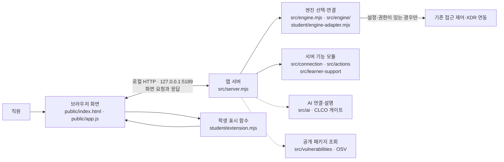

# 모몽강 보안 Agent — 시작 틀 0.2.11

이 프로젝트는 ALEPH 방어전에서 학생이 단계별로 확장하는 로컬 보안 Agent 앱입니다. 직원이 **본인 로그인·기기·현재 세션 상태**, **업무 앱 접근 요청 결과**, **접속 기록과 XDR 경보**를 확인하고, 연결이 준비된 경우 보안 기록의 근거를 읽기 쉽게 살펴보는 것이 목적입니다. 이름 「모몽강」은 이 README에서 사용하는 Agent 이름입니다. 패키지명, 시작 스크립트명, 폴더·파일 이름과 실행 중인 앱 제목을 자동으로 바꾸지는 않습니다.

이 시작 틀만 받았다고 과제 단계가 통과되지는 않습니다. 학생은 안내된 단계의 학생용 표시 함수만 구현하고, 화면을 직접 확인한 뒤 커밋을 제출합니다. 공식 판정은 제출된 커밋의 코드를 기준으로 하며, 이 README나 앱 실행만으로 판정 결과를 보장하지 않습니다.

## 기능과 경계

- **보호 현황:** 현재 계정·기기·세션, 연결 상태, 알림과 진단 정보를 확인합니다. 실제 데이터는 승인된 연결이 제공할 때만 표시됩니다.
- **업무 앱:** 선택한 앱에 대한 접근 판정과 이유·시각을 표시합니다. `allow`는 정책상 허용 판정이며 실제 앱 접속 성공을 보장하지 않습니다. 전체 권한 목록을 조회하는 기능도 아닙니다.
- **보안 기록:** 제공된 범위의 접속 기록과 XDR 경보를 살펴보고 기록의 근거·규칙·현재 상태를 확인합니다. AI 설명은 참고용이며 사건 사실을 대신 판정하지 않습니다.
- **AI 연결:** 연결 점검과 사건 설명 요청은 별개입니다. 모델 목록 점검만으로 사건 설명을 실행한 것이 아닙니다. AI 실패는 기존 접근 판정과 기록 조회의 성공·실패를 대신하지 않습니다.
- **보안 조치:** 지원되는 연동 경로가 있을 때 제공 화면에서 사람 확인과 서버 결과 조회를 구분합니다. 기본 실행에서 조치 연동이 없거나 기록의 `supportedActions`가 비어 있으면 조치 준비가 제공되지 않는 것이 정상입니다. 학생 코드는 조치를 집행하지 않습니다.
- **설치 패키지 조회:** 담당자가 공개 조회를 승인한 npm 패키지만 정확한 설치 버전 기준으로 OSV의 알려진 취약점 정보와 대조합니다. 미조회·일부 실패·확인 불가는 취약점 없음이 아니며, 취약점이 없다는 결과도 앱 전체의 안전을 보장하지 않습니다.

일부 연동은 운영자 설정과 현재 사용자 권한이 있어야 합니다. 앱 서버가 실행되는 것, 예제 화면이 보이는 것, 연결 점검 결과가 있는 것은 실제 회사 시스템 연결이나 단계 성취를 증명하지 않습니다.

## 지원 환경과 버전

| 항목 | 현재 프로젝트에서 확인한 값 |
| --- | --- |
| 앱 폴더 | `on-client/` |
| 패키지 메타데이터 | `alekov-client-starter` `0.2.11` (`package.json`) |
| Node.js | `package.json`의 `engines.node`: `24.19.0` |
| npm 스크립트 | `start`, `demo`, `check` |
| 외부 npm 의존성 | `package.json`에 `dependencies`·`devDependencies` 선언 없음 |
| 기본 접속 주소 | `http://127.0.0.1:5189/` |
| 기본 연결 상태 | 실제 엔진·계정에 연결되지 않은 상태. `demo`는 예제 자료 |
| 실행 안내 환경 | Windows PowerShell 실행 스크립트가 제공됨. 다른 운영체제에서의 실행은 이 문서 범위에서 검증하지 않음 |

위 Node.js 값은 프로젝트가 요구하는 버전이며, 사용 중인 PC에 설치된 버전을 뜻하지 않습니다. `package-lock.json`은 현재 이 작업에서 파일로 확인하지 못했습니다. 따라서 잠금 파일의 존재·내용·해시와 실제 설치 상태를 확인했다고 말할 수 없습니다. 임의로 잠금 파일을 만들거나 의존성을 업데이트하지 마세요. `docs/STUDENT_LAUNCH_GUIDE.md`에는 Node.js 22~24라는 별도 안내가 있으므로 버전 표기가 서로 다릅니다. 실행 전 `package.json`의 정확한 선언인 `24.19.0`을 기준으로 담당자 지침을 확인하세요.

## 설치와 실행

프로젝트에 외부 npm 의존성이 선언되어 있지 않으므로 기본 안내에는 패키지 설치 단계를 두지 않습니다. 로컬 PC의 Node.js·npm 버전은 직접 확인하세요.

1. 파일 탐색기에서 저장소 안의 `on-client` 폴더를 엽니다.
2. 주소 표시줄에 `powershell`을 입력하고 Enter를 눌러 해당 폴더에서 PowerShell을 엽니다.
3. 버전을 확인합니다.

   ```powershell
   node --version
   npm --version
   ```

   프로젝트가 선언한 Node.js 버전은 `v24.19.0`입니다.

4. 기본 서버를 실행합니다.

   ```powershell
   powershell -NoProfile -ExecutionPolicy Bypass -File .\tools\start-alekov.ps1
   ```

5. 브라우저에서 `http://127.0.0.1:5189/`를 엽니다. 서버 시작 메시지는 로컬 서버가 응답했다는 뜻일 뿐, 사용자·기기·업무 시스템·AI 연결 성공을 뜻하지 않습니다.
6. 종료하려면 실행 중인 PowerShell 창에서 `Ctrl+C`를 누릅니다. 다시 켤 때는 같은 폴더에서 실행 명령을 다시 사용합니다.

`npm start`도 `node src/server.mjs`로 서버를 시작합니다. `npm run demo`는 예제 모드이지 실제 연결이 아닙니다. `npm run check`는 `student/extension.mjs`의 문법 검사만 수행하며 브라우저 동작이나 과제 통과를 검사하지 않습니다. 포트 변경이 필요하면 제공된 실행 도구와 `docs/STUDENT_LAUNCH_GUIDE.md`의 안내를 따르고, 실제 주소와 포트가 맞는지 확인하세요.

계정 연결용 native 호스트와 SDP 호스트는 서로 다른 선택 설정입니다. 담당자가 본인 프로젝트용 설정과 실행 절차를 제공한 경우에만 `tools/start-alekov.ps1`의 `-NativeHostConfig` 또는 `-SdpHostConfig` 옵션을 안내받은 절대 경로와 함께 사용합니다. 설정 파일을 직접 만들거나 복사하지 말고, 내용·경로·인증 정보도 채팅이나 커밋에 넣지 마세요. 상세 절차는 [계정·AI 연결 안내](docs/AI_SETUP_GUIDE.md)와 [SDP host 연결 안내](docs/SDP_HOST_CONNECTION.md)를 따릅니다.

## 구성과 데이터 흐름



브라우저의 제공 UI가 로컬 서버에서 자료를 받고, `student/extension.mjs`의 학생 표시 함수가 과제 계약에 따라 화면용 DOM을 반환합니다. 서버는 `src/`의 엔진·연결·AI·조치·학습 지원·취약점 조회 모듈을 통해 자료를 처리합니다. 연결 대상이 설정되지 않거나 권한이 확인되지 않으면 성공 자료를 만들어 내지 않고 연결 없음·확인 불가·오류 상태를 반환해야 합니다. 다이어그램의 점선은 선택적 연동 경로를 뜻하며 현재 PC에서 연결됐다는 주장이 아닙니다. 학생 표시 코드는 서버 권한·탐지·실제 조치 실행을 대체하지 않습니다.

## 제공 코드와 학생 작성 부분

| 부분 | 경로 | 역할 |
| --- | --- | --- |
| 시작 안내·실행 도구 | `README.md`, `tools/start-alekov.ps1`, `package.json` | 제공된 프로젝트와 실행 절차. 실행에 쓰는 이름을 유지합니다. |
| 브라우저 화면·공통 UI | `public/` | 제공 UI, 메뉴, 서버 요청 및 화면 연결. 단계 안내가 명시하지 않으면 수정하지 않습니다. |
| 서버·연동 모듈 | `src/` | 제공 서버, 엔진, 연결, AI, 조치, OSV 기능. 인증·판정·서버 코드를 학생 표시 구현으로 바꾸지 않습니다. |
| 학생 표시 구현 | `student/extension.mjs` | 과제에서 지정한 `render...` 함수의 표시 영역. 각 단계에서 지정된 함수만 수정합니다. |
| 엔진 어댑터 | `student/engine-adapter.mjs` | 앱과 엔진 사이의 제공 연결 경계이며 계정·권한 설정을 임의로 생성하는 곳이 아닙니다. |
| 안내 문서 | `docs/` | 실행, 단계 계약, 연결, 장애 해결과 기능 범위에 관한 참고 자료입니다. |

학생 작성 함수는 제공 UI가 전달한 값을 안전하게 텍스트로 표현하는 역할입니다. 데이터가 없거나 연결이 실패한 상태를 성공·정상으로 꾸미지 않습니다. DOM 출력은 사용자 입력을 HTML로 실행하지 않도록 `textContent`를 사용하고, 앞 단계 함수와 제공 파일은 해당 단계 안내 없이 수정하지 않습니다.

## 장애 확인과 복구

먼저 화면의 상태 문구와 오류 코드를 확인하세요. 이름·ID 대신 오류 코드와 발생한 단계만으로 담당자에게 문의할 수 있습니다. 열쇠·토큰·비밀번호·개인 설정 파일 내용은 보내지 마세요.

| 증상 | 확인·복구 순서 | 해석 주의 |
| --- | --- | --- |
| 브라우저에서 앱이 열리지 않음 | PowerShell의 현재 폴더가 `on-client`인지 확인 → Node.js 버전 확인 → 서버가 계속 실행 중인지 확인 → 주소·포트와 포트 충돌 여부를 `docs/STUDENT_LAUNCH_GUIDE.md`에서 확인 → 사용자가 직접 다시 실행 | 시작 메시지는 계정·엔진 연결의 증거가 아닙니다. |
| `연결 없음`, 요청 실패 또는 `NATIVE_HOST_DISABLED` | 기본 실행에는 연결 설정이 포함되지 않을 수 있습니다. `docs/CONNECTION_TROUBLESHOOT.md`의 해당 오류를 확인하고, native 호스트 설정이 필요한 계정 연결은 담당자에게 발급·실행 절차를 요청합니다. 받은 설정이 있으면 안내된 경로만 사용해 앱을 다시 실행합니다. | SDP 설정은 native 계정 연결 설정을 대신하지 않으며 그 반대도 마찬가지입니다. 설정을 직접 만들거나 다른 사람의 파일을 복사하지 않습니다. |
| SDP 조회에서 `확인 불가` 또는 연결 오류 | `docs/SDP_HOST_CONNECTION.md`와 담당자 안내를 확인합니다. 개인 설정과 권한이 없으면 읽기·판정 자료를 임의로 만들지 말고 담당자에게 문의합니다. | 문서에 적힌 로컬·합성 검증은 실제 학생 계정이나 운영 연결을 증명하지 않습니다. |
| AI 권한·인증·한도·시간 초과·네트워크 오류 | 오류 코드와 안전한 도움정보를 확인하고 `docs/AI_SETUP_GUIDE.md`의 코드별 안내를 따릅니다. 담당자에게 계정 권한·이용 시간·한도·모델 설정을 확인합니다. 복구 뒤에도 다시 점검은 사용자가 직접 시작합니다. | 모델 연결 점검은 사건 설명이 아닙니다. Workbench 또는 공급사 열쇠를 복사하지 않습니다. |
| 기록이 없음 또는 기록 조회 실패 | 화면에서 빈 목록과 오류 문구를 구분합니다. 제공된 다시 불러오기 버튼을 사용자가 직접 눌러 재시도하고, 계속 실패하면 연결 상태와 오류 코드를 담당자에게 전달합니다. | 빈 목록은 조회 실패가 아니며, 실패는 기록이 없다는 뜻이 아닙니다. |
| 패키지 결과가 `not_configured`, `not_checked`, `partial` 또는 `unverifiable` | 조회 대상 공개 패키지 설정은 담당자에게 확인하고, 화면의 패키지별 출처·정확한 버전·조회 시각·상태를 살핍니다. 부분 실패에서는 이미 받은 취약점 ID를 지우지 않습니다. | 미조회·일부 실패·확인 불가는 `none_found`가 아닙니다. 학생이 allowlist나 의존성을 임의로 바꾸지 않습니다. |
| 조치 준비가 표시되지 않음 | 해당 기록의 `supportedActions`와 연결 안내를 확인합니다. 지원 조치가 없는 기록에서는 조치 준비가 보이지 않는 것이 정상입니다. | 학생 표시 함수에서 조치 요청을 만들거나 실제 집행을 시험하지 않습니다. |

세션 화면은 현재 검증된 연결 하나를 보여 줄 수 있으며 과거 세션 전체 목록을 뜻하지 않습니다. 기기 보안 상태 표시는 악성코드 검사·치료 기능이 아닙니다. 알려진 OSV 항목이 없다는 결과도 모든 취약점이나 침해가 없음을 증명하지 않습니다. 상세한 연결 오류는 [연결 문제 해결](docs/CONNECTION_TROUBLESHOOT.md), AI 관련 내용은 [AI 연결 안내](docs/AI_SETUP_GUIDE.md)를 참고하세요.

## 미확인 범위와 참고 문서

이 문서를 작성할 때 앱을 실행하거나 브라우저를 열지 않았고, Node/npm 설치 상태·자동 검사·모의 데이터·실제 계정·실제 SDP·AI 호출·외부 OSV 조회도 확인하지 않았습니다. Git 상태, 커밋, 단계 판정도 확인하지 않았습니다. 따라서 위 실행 절차는 프로젝트 파일과 제공 안내에 근거하며 실제 PC에서 동작을 확인했다는 뜻이 아닙니다.

- 단계별 과제 안내: `docs/STUDENT_PROMPTS.md`, `docs/CURRICULUM.json`, `docs/IMPLEMENTATION_CONTRACT.md`
- 학생 실행 방법: `docs/STUDENT_LAUNCH_GUIDE.md`
- 제품 역할·기능 개요: `docs/PRODUCT_OVERVIEW.md`
- 오류 코드와 연결 복구: `docs/CONNECTION_TROUBLESHOOT.md`
- 계정·AI 연결 및 범위: `docs/AI_SETUP_GUIDE.md`
- SDP host 설정과 검증 경계: `docs/SDP_HOST_CONNECTION.md`
- OSV 조회 구현·테스트 범위: `src/vulnerabilities/README.md`
- 최종 제공 기준: `docs/FINAL_PRODUCT_GUIDE.md`

기존 프로젝트 파일과 실행 이름을 보존하세요. 제공된 시작 틀만으로 단계 통과, 실제 시스템 연결, 악성코드 탐지·치료, 실제 보안 조치 집행을 주장하지 않습니다.
