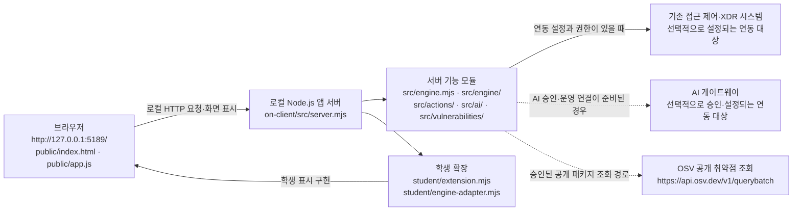

# 모몽강 학생 실행 설명서 및 구성도

이 문서는 **모몽강** 보안 Agent 과제 프로젝트를 다른 사람이 자기 PC에서 실행할 수 있도록, 실제 폴더 위치와 명령, 제공 코드와 학생 작성 부분, 확인 범위를 정리합니다. 모몽강은 이 문서에서 사용하는 Agent 표시 이름입니다. 이름을 문서에 적어도 패키지명, 실행 스크립트명, 파일·폴더명, 실행 중 앱 제목이 자동으로 바뀌지는 않습니다. 예를 들어 `tools/start-alekov.ps1`은 받은 이름 그대로 사용합니다.

## 1. 이 프로젝트에서 확인한 실행 환경

| 항목 | 프로젝트에서 확인한 내용 | 확인 범위 |
|---|---|---|
| 앱 폴더 | 저장소 안의 `on-client/` | 프로젝트 파일 경로 |
| Node.js | `package.json`의 `engines.node`는 `24.19.0` | 프로젝트가 선언한 버전. 이 PC에 설치된 버전은 확인하지 않음 |
| 앱 패키지 | `alekov-client-starter` 버전 `0.2.11` | `on-client/package.json`의 메타데이터이며 앱 화면 제목을 뜻하지 않음 |
| npm 명령 | `start`, `demo`, `check` 스크립트가 정의됨 | `on-client/package.json` |
| 외부 npm 의존성 | `package.json`에 `dependencies` 또는 `devDependencies` 선언이 없음 | 매니페스트만 확인. 설치된 `node_modules` 상태는 확인하지 않음 |
| 잠금 파일 | 프로젝트 파일 목록에서 `package-lock.json`을 찾지 못함 | 현재 확인 가능한 프로젝트 파일 기준 |
| 브라우저 주소 | 기본 주소는 `http://127.0.0.1:5189/`로 안내됨 | 학생 실행 안내 문서 기준. 이 세션에서 앱을 실행해 검증하지 않음 |

`package.json`은 Node.js를 `24.19.0`으로 선언하지만, 기존 `docs/STUDENT_LAUNCH_GUIDE.md`에는 Node.js `22~24`라고 적혀 있습니다. 문서 간 버전 차이가 있으므로 이 실행 설명서는 **현재 `package.json`의 정확한 선언인 Node.js `24.19.0`을 기준으로 안내**합니다. 실제 설치 버전은 실행 전에 `node --version`으로 확인하세요. 이 설명서를 작성하면서 설치·업데이트·외부 네트워크 요청은 하지 않았습니다.

## 2. 프로젝트 폴더 구조

아래는 이번 실행과 관련된 실제 파일 경로의 요약입니다. 파일명과 폴더명은 받은 그대로 유지합니다.

```text
<저장소 루트>/
└─ on-client/                         앱 프로젝트 폴더
   ├─ package.json                   Node.js 버전 선언 및 start/demo/check 명령
   ├─ README.md                      제공 시작 안내
   ├─ tools/
   │  └─ start-alekov.ps1            Windows PowerShell 실행 도구
   ├─ public/                        브라우저 화면 및 제공 UI 코드
   │  ├─ index.html
   │  ├─ app.js
   │  ├─ ai-connect.mjs
   │  └─ vulnerabilities-view.mjs
   ├─ src/                           앱 서버 및 서버 기능 모듈
   │  ├─ server.mjs
   │  ├─ engine.mjs
   │  ├─ engine/
   │  ├─ ai/
   │  ├─ actions/
   │  ├─ connection/
   │  ├─ learner-support/
   │  └─ vulnerabilities/
   ├─ student/                       학생 확장 코드
   │  ├─ extension.mjs
   │  └─ engine-adapter.mjs
   └─ docs/                          제공 안내와 학생 문서
      └─ STUDENT_RUNBOOK.md          이 실행 설명서
```

`on-client`는 실행에 필요한 앱 폴더입니다. 이 과제의 Git 저장소 최상위 폴더는 그 위의 프로젝트 루트일 수 있습니다. **앱 실행은 `on-client`에서, 과제 커밋·제출 절차는 해당 프로젝트의 Git 최상위에서** 합니다. 기존 작업 폴더나 파일을 지우고 새로 만들 필요는 없습니다.

## 3. 설치·실행·종료·재실행

### 준비

1. Windows에서 PowerShell을 사용할 수 있어야 합니다. 이 저장소의 기본 실행 명령은 PowerShell 스크립트입니다.
2. Node.js `24.19.0`을 준비합니다. 설치 여부와 버전은 PowerShell에서 확인할 수 있습니다.

   ```powershell
   node --version
   npm --version
   ```

   `node --version`이 `v24.19.0`인지 확인하세요. 이 안내에서는 Node.js나 npm을 설치하지 않습니다.

### 실행

1. 파일 탐색기에서 `<저장소 루트>\on-client` 폴더를 엽니다.
2. 탐색기 주소 표시줄에 `powershell`을 입력하고 Enter를 누릅니다. 열린 창의 작업 위치가 `on-client`인지 확인합니다.
3. 다음 명령을 그대로 실행합니다.

   ```powershell
   powershell -NoProfile -ExecutionPolicy Bypass -File .\tools\start-alekov.ps1
   ```

4. 기존 `docs/STUDENT_LAUNCH_GUIDE.md`가 안내하는 시작 신호는 다음 문구와 로컬 주소입니다.
   - `케셰브가 켜졌습니다. 브라우저에서 http://127.0.0.1:5189/ 을 여세요.` (받은 시작 틀에 따라 이름이나 출력이 다를 수 있습니다.)
   - `서버가 응답한 것만 확인했습니다. AI 연결 상태는 화면에서 따로 확인해 주세요.`

   이 신호는 앱 서버가 응답했다는 뜻일 뿐, 외부 엔진·AI·계정 연결의 성공을 뜻하지 않습니다. 이 문서를 작성하면서 실행 도구의 명령을 실제로 실행하거나 이 출력 문구를 재현하지 않았습니다.
5. 브라우저에서 아래 주소를 엽니다.

   ```text
   http://127.0.0.1:5189/
   ```

### 종료와 재실행

- 실행 중인 PowerShell 창에서 `Ctrl+C`를 눌러 서버를 종료합니다.
- 다시 실행할 때는 같은 `on-client` 폴더에서 위 PowerShell 실행 명령을 다시 실행합니다.
- `package.json`에는 대체 실행 명령 `npm start`도 있으며, 이는 `node src/server.mjs`를 실행합니다. 기본 실행 안내에서는 먼저 제공된 PowerShell 스크립트를 사용하세요.
- `npm run demo`는 예제 모드이며 실제 계정·엔진 연결을 증명하지 않습니다. `npm run check`는 `student/extension.mjs`의 Node.js 문법 검사용 스크립트이며 앱 화면 동작 검사는 아닙니다.
- 포트 `5189`가 사용 중일 때 실행 스크립트의 `-Port` 인자를 쓰는 방법은 기존 `docs/STUDENT_LAUNCH_GUIDE.md`의 문제 해결 안내를 따르세요. 포트를 바꾸면 브라우저 주소의 포트도 같은 값으로 바꿔야 합니다.

## 4. 글로 표현한 시스템 구성도



구성도의 의미:

- 브라우저는 이 PC의 loopback 주소 `127.0.0.1`에 있는 앱 서버와 통신합니다. `public/`은 화면과 제공 UI, `src/`는 서버 측 모듈, `student/`는 학생 확장 코드의 위치입니다.
- 기존 접근 제어·XDR 시스템은 판정·탐지 정보를 제공하는 별도 연동 대상입니다. 앱이 로컬에서 켜졌다는 사실만으로 이 연결이 성립하지 않습니다.
- AI 게이트웨이는 별도 승인과 운영 설정이 필요한 대상입니다. 연결 점검과 보안 기록의 AI 설명 요청은 서로 다른 동작이며, 모델 목록 점검만으로 사건 설명이 완료된 것은 아닙니다.
- OSV 주소는 패키지 조회 화면 코드에 선언된 공개 조회 출처입니다. 프로젝트 안내는 담당자가 승인한 공개 패키지만 조회하도록 제한합니다. 이 문서를 쓰면서 외부 조회를 실행하지 않았습니다.
- Mermaid의 점선은 선택적 연동 경로이며, 현재 PC에서 연결이 확인됐다는 표시가 아닙니다. 비밀 설정의 값이나 개인 파일 경로는 이 문서에 적지 않습니다.

## 5. 제공 코드와 학생 작성 부분

| 범위 | 실제 위치 | 역할과 경계 |
|---|---|---|
| 브라우저 화면·제공 메뉴 | `on-client/public/index.html`, `on-client/public/app.js`, `on-client/public/*.mjs` | 제공 UI 및 브라우저 모듈. 과제 안내가 지정하지 않는 한 수정하지 않습니다. |
| 앱 서버와 서버 기능 | `on-client/src/server.mjs`, `on-client/src/` | 로컬 서버, 엔진·AI·조치·취약점 조회 관련 모듈. 제공 코드이며 학생이 서버·인증·판정 코드를 바꾸는 단계가 아닙니다. |
| 학생 확장 | `on-client/student/extension.mjs` | 단계별 학생 화면 표시 함수가 들어가는 파일입니다. 함수 계약에 맞춰 학생 구현을 보존합니다. |
| 엔진 연결 어댑터 위치 | `on-client/student/engine-adapter.mjs` | 학생/프로젝트 연결 경계에 있는 파일입니다. 운영 설정을 임의로 만들거나 자격 정보를 넣지 않습니다. |
| 실행 스크립트 | `on-client/tools/start-alekov.ps1` | Windows용 앱 실행 도구입니다. 파일명을 바꾸지 않습니다. |

과제에서 함수별 학생 표시 계약으로 다루는 함수는 `renderIdentity`, `renderDecision`, `renderEvents`, `renderStatus`, `renderAiConnection`, `renderExplanation`, `renderAction`, `renderVulnerabilities`입니다. 함수 이름과 과제 대상은 계약 설명과 문서에서 확인했지만, 이 표는 실행 테스트 결과가 아닙니다. 학생 코드는 제공 UI나 서버의 결과를 읽어 표시하는 범위이며, 직접 인증 우회·접근 판정·XDR 탐지·실제 조치 집행을 만드는 것으로 설명하지 않습니다.

## 6. 기능·오류 확인 순서와 현재 한계

| 증상 또는 확인하려는 것 | 확인 순서 | 성공으로 오해하지 말아야 할 점 |
|---|---|---|
| 브라우저에서 앱이 열리지 않음 | PowerShell이 `on-client`에서 열렸는지 확인 → 서버가 실행 중인지 확인 → 주소와 포트 확인 → 포트 충돌이면 기존 실행 안내의 `-Port` 절차 확인 | 서버 시작 메시지만으로 엔진 또는 계정 연결을 판단하지 않습니다. |
| Node.js 실행 오류 | `node --version` 확인 → 프로젝트 선언 버전 `24.19.0`과 비교 → 버전이 다르면 담당된 설치 절차를 따르고 새 PowerShell에서 재확인 | 이 문서 작성 중 로컬 Node.js 버전을 확인하지 않았습니다. |
| 계정 또는 기존 엔진 연결 없음 | 화면의 연결 상태와 안전한 오류 코드를 확인 → 기존 `docs/CONNECTION_TROUBLESHOOT.md`, `docs/SDP_HOST_CONNECTION.md` 및 담당자 안내 확인 | 기본 실행의 `연결 없음` 또는 `확인 불가`는 연결 성공이 아닙니다. 설정 파일이 안내되지 않았다면 만들거나 복사하지 말고 담당자에게 문의합니다. |
| AI 연결 또는 사건 설명 실패 | `docs/AI_SETUP_GUIDE.md`와 연결 오류 안내를 확인 → 연결 점검과 별도 사건 설명 요청을 구분 → 승인·권한 준비 상태는 담당자에게 확인 | AI 연결 점검 성공은 사건 설명 성공이 아니며, 오류·취소·확인 불가는 성공이 아닙니다. 열쇠·토큰·비밀번호를 문서나 채팅에 붙이지 않습니다. |
| 기록이 비어 있거나 조회 실패 | 화면 문구와 안전한 오류 코드를 구분 → 제공된 다시 불러오기 동작을 사용자가 직접 수행 → 같은 문서의 연결 문제 해결 안내 확인 | 빈 목록은 조회 실패가 아니고, 실패는 빈 목록이나 정상 상태가 아닙니다. 자동 재시도를 가정하지 않습니다. |
| 패키지 결과가 미조회·일부 실패·확인 불가 | 화면의 전체 조회 상태·패키지 상태·조회 시각과 잠금 파일 관련 정보를 확인 → `docs/`의 패키지 조회 안내 확인 | 미조회·일부 실패·확인 불가는 취약점 없음 또는 앱이 안전하다는 뜻이 아닙니다. 이 문서 작성 중 OSV 조회를 하지 않았습니다. |

### 확인한 것과 확인하지 않은 것

**파일 읽기로 확인한 것**

- `on-client/package.json`의 패키지 메타데이터, Node.js 버전 선언, `start`·`demo`·`check` 스크립트.
- 프로젝트 파일 목록의 실행 도구, `public/`, `src/`, `student/`, `docs/` 경로와 기존 학생 실행 안내에 적힌 기본 폴더·주소·종료 방법.
- 제공된 패키지 조회 화면 코드가 OSV 주소를 명시한다는 점.

**아직 확인하지 않은 것**

- 이 PC에 설치된 Node.js·npm 버전과 실행 환경.
- PowerShell 실행 스크립트의 실제 실행, 서버 시작 메시지, 브라우저에서의 실제 화면.
- 실제 사용자·기기·세션, 접근 판정, XDR 경보, AI 게이트웨이·모델 응답, 외부 OSV 조회.
- 앱 동작의 모의 데이터 테스트, 자동 검사 실행, Git 상태·커밋·과제 판정.

이 문서는 학생 실행 절차와 현재 확인 범위를 설명할 뿐, 실제 연동 성공이나 단계 통과를 증명하지 않습니다. 실제 화면에서 확인하지 않은 기능은 미확인으로 남깁니다.

## 7. 참고 문서

- [제공 README](../README.md)
- [학생 실행 안내](STUDENT_LAUNCH_GUIDE.md)
- [제품 개요 및 역할 경계](PRODUCT_OVERVIEW.md)
- [최종 제품 제공 기준](FINAL_PRODUCT_GUIDE.md)
- [연결 문제 해결](CONNECTION_TROUBLESHOOT.md)
- [SDP 연결 안내](SDP_HOST_CONNECTION.md)
- [AI 연결 안내](AI_SETUP_GUIDE.md)
